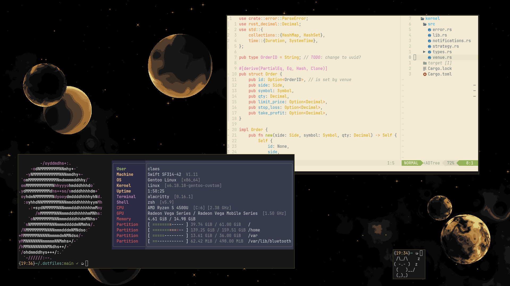

# Dotfiles



`git clone https://github.com/ACLzz/dotfiles.git ~/.dotfiles; cd ~/.dotfiles`

## How to use
If used on Ubuntu:
- Login into root, and run `task install:apt`
- Optional: run `task install:apt:extra`

If used on Gentoo:
Install software from software list manually (all of them are in portage)

General steps:
- Run `task install` to install local user software
- Run `task stow` to stow dotfiles


You can run `task update` to fetch new dotfiles version while preserving your local config

## TODO
(Waiting for new laptop)
- Install librewolf extensions && config
- Apply vimium config to librewolf
- Add kernel configs

## Software list

```txt
alacritty
gammastep
sway
mako
tofi
wireplumber
xdg-desktop-portal-wlr
slurp
wl-clipboard
zsh
zoxide
bibata-xcursors
stow
cowsay
neovim
jetbrains-mono
lua
python3-venv
```

Build dependencies:
```text
wget
make
liblua5.1-dev // lua.h for luarocks
unzip
```

VR extra:
```text
sunshine
```

Other extra:
```text
fastfetch
```