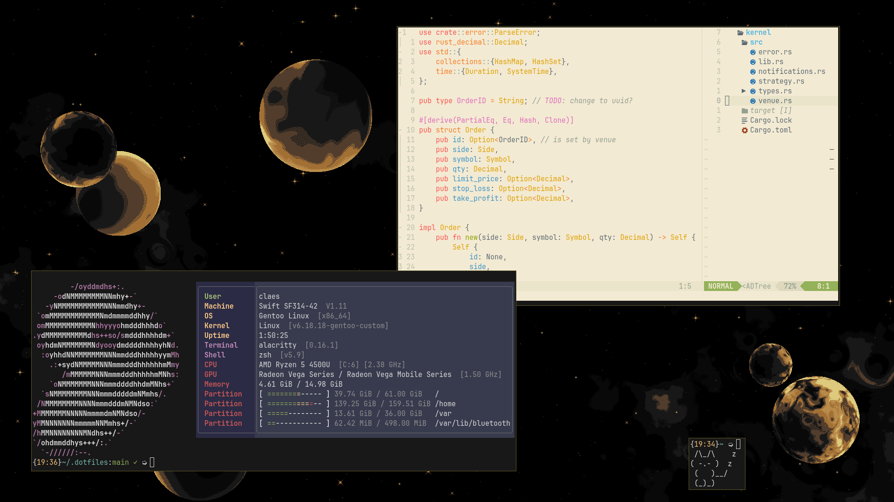

# Dotfiles
My collection of dotfiles focused on performance and responsivness of the system



`git clone https://github.com/ACLzz/dotfiles.git ~/.dotfiles; cd ~/.dotfiles`

## How to use
If used on Ubuntu:
- Login into root, and run `task install:apt`
- Optional: run `task install:apt:extra`


If used on Gentoo:
Install software from software list manually (all of them are in portage)


General steps:
- Run `task install` to install local user software
- Run `task stow` to stow dotfiles


You can run `task update` to fetch new dotfiles version while preserving your local config

## TODO
(Waiting for new laptop)
- Install librewolf extensions && config
- Apply vimium config to librewolf
- Add kernel configs
- Make theme monochrome

## Software list

```txt
alacritty
bibata-xcursors
cowsay
gammastep
jetbrains-mono
lua
mako
neovim
slurp
stow
sway
tofi
wireplumber
wl-clipboard
xdg-desktop-portal-wlr
zoxide
zsh
```

Build dependencies:
```text
liblua5.1-dev // lua.h for luarocks
make
python3-venv // for CHADTree to build
unzip
wget
```

VR extras:
```text
sunshine
```

Other extras:
```text
fastfetch
sox
```
